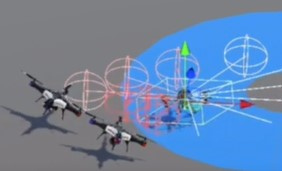
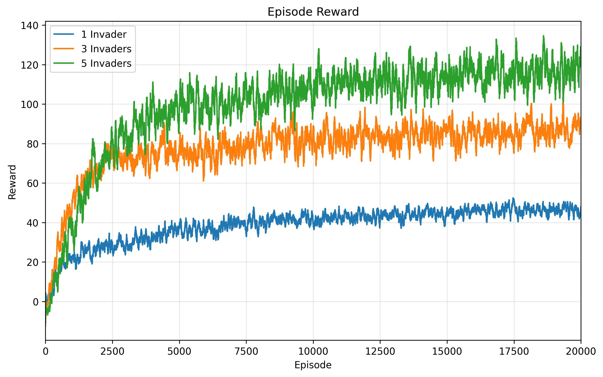
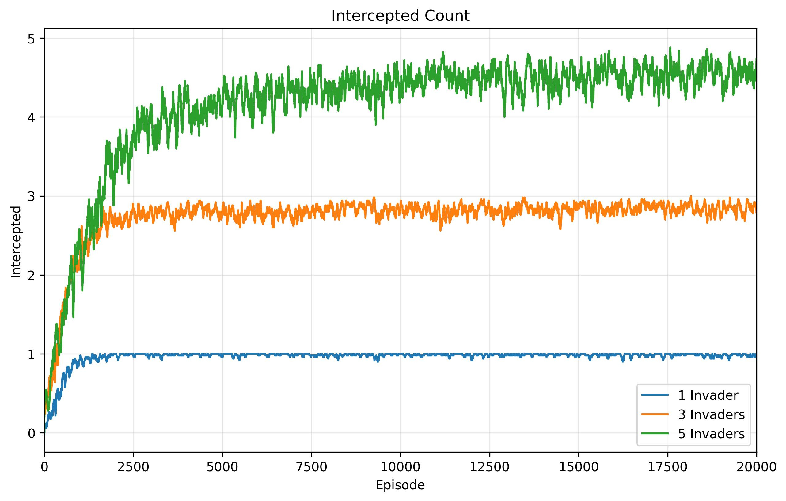
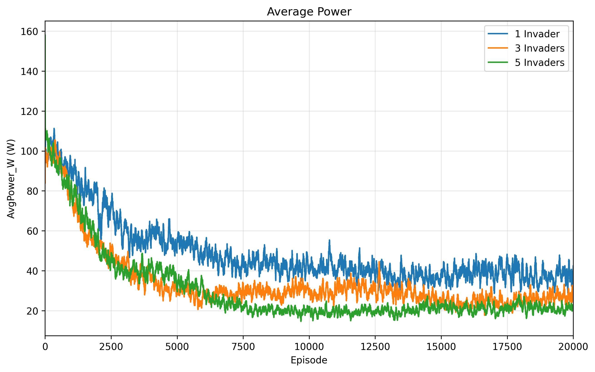
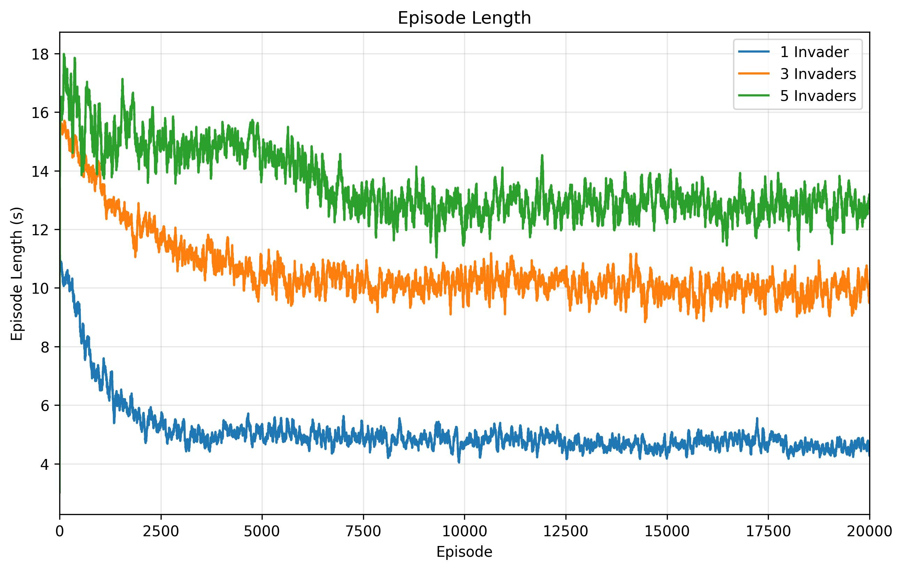

# Unity ML-Agents 기반 다중 침입 드론 요격 시스템

> **Unity · C# · ML-Agents · Reinforcement Learning · Rigidbody Physics · PD Control**

Unity 물리 시뮬레이션에서 **방어 드론이 여러 침입 드론을 탐지하고 요격하도록 학습하는 강화학습 프로젝트**입니다. 침입 드론은 방어 구역 중심으로 접근하며, 방어 드론은 관측 정보와 연속 행동을 바탕으로 이동·자세를 제어합니다. 접근 및 탐지 유지 보상, 요격 성공 보상, 방어 구역 침입 페널티를 조합하고 에피소드별 에너지·이동거리·성공 여부를 CSV로 기록합니다.


<p align="center">
  
</p>

<p align="center"><strong>Unity 시뮬레이션 — Ray 기반 침입 드론 탐지 및 요격</strong></p>

<p align="center">🎬 <a href="https://www.youtube.com/watch?v=-DQ-wIZJNSE">YouTube에서 시뮬레이션 시연 영상 보기</a></p>

## 1. 시스템 구성

```text
Unity Simulation
├── Invasion Drone (침입 드론)
│   └── DroneFlightController.cs
│       ├── 맵 중심 (0, y, 0) 방향 이동
│       ├── Rigidbody 기반 속도·자세 제어
│       ├── 침입 드론 간 반발력 기반 간격 유지
│       └── 맵 경계 복귀력
│
└── Defense Drone (방어 드론)
    ├── DroneAgent.cs (ML-Agents Agent)
    │   ├── 상태 관측 / 연속 행동 / 보상 계산
    │   ├── 레이 기반 탐지 및 타깃 선택
    │   ├── 침입 드론 순차 스폰 / 커리큘럼
    │   ├── 요격·침입·종료 판정
    │   └── 에피소드 통계 / CSV 로깅
    └── DroneController.cs
        ├── 6DoF 명령 → 목표 속도·각속도
        ├── 선형·회전 PD 제어
        ├── 모터 명령 지연 / 능동 제동
        ├── 선택적 OU 탐색 노이즈 / 바람 외란
        └── 고도·경계·하강 안전 제어
```

### 주요 소스 파일

| 파일 | 클래스 | 주요 책임 |
|---|---|---|
| `DroneFlightController.cs` | `DefenseDrone.DroneFlightController` | 침입 드론의 원점 접근, Yaw·Pitch·Roll 안정화, 침입 드론 간 간격 유지 |
| `DroneController.cs` | `DroneController` | 방어 드론의 Rigidbody 기반 6자유도 이동, 속도·각속도 제어, 물리적 제약 |
| `DroneAgent.cs` | `DroneAgent`, `TriggerRelay` | 강화학습 인터페이스, 레이 탐지, 보상 설계, 에피소드 관리, 통계 저장 |

> 첨부 파일은 `.txt`로 전달되었으며, 위 `.cs` 파일명은 각 클래스에 맞춰 README에서 제안한 이름입니다.

## 2. 시뮬레이션 및 강화학습 환경

- **목표:** 침입 드론이 중심 방어 구역에 도달하기 전에 요격
- **에이전트:** ML-Agents의 `Agent`를 상속한 방어 드론
- **침입 드론:** `maxInvadersPerEpisode` 기본값 **3대**, `invaderSpawnInterval` 기본값 **2초** 간격으로 활성화
- **맵:** X/Z 좌표 기본 범위 **-50 ~ 50** (방어 드론 컨트롤러 기준)
- **탐지:** `detectRange = 60`, 별도의 11방향 레이캐스트 (`perceptionRayLength = 90`)
- **침입 판정:** XZ 평면의 중심 반경 `zoneFailRadius = 18`에 도달하면 침입 성공 처리
- **요격 보상:** 요격 성공 시 기본 `+10`, 침입 성공 시 기본 `-4`
- **종료:** 모든 침입 드론이 요격 또는 침입으로 처리되거나 경계 이탈·충돌 등 종료 조건이 발생한 경우

모든 값은 **소스코드의 초기값**이며 Unity Inspector에서 재설정할 수 있습니다.

### 관측 공간 (Observation Space)

`CollectObservations()`는 다음 14개 스칼라를 순서대로 기록합니다.

| 관측값 | 차원 | 정규화/의미 |
|---|---:|---|
| 방어 드론 로컬 위치 | 3 | `localPosition / 50` |
| 방어 드론 속도 | 3 | `velocity / 20` |
| 타깃 상대 위치 | 3 | `(targetPosition - agentPosition) / 80` |
| 타깃 상대 속도 | 3 | `(targetVelocity - agentVelocity) / 20` |
| 타깃 거리 | 1 | `Clamp01(distance / 30)` |
| 타깃 존재 여부 | 1 | 존재 1 / 부재 0 |

**주의:** 11방향 레이캐스트는 타깃 선택 및 보상 계산에 사용되지만, 첨부된 `CollectObservations()`에는 레이별 거리값이 직접 추가되어 있지 않습니다. 별도의 센서 컴포넌트 연결 여부는 제공된 코드만으로 확인할 수 없습니다.

### 행동 공간 (Action Space)

`OnActionReceived()`는 **연속 행동 6개**를 사용합니다.

| 인덱스 | 명령 | 역할 |
|---:|---|---|
| 0 | `tx` | 좌우 이동 |
| 1 | `ty` | 상하 이동 |
| 2 | `tz` | 전후 이동 |
| 3 | `pitch` | Pitch 각속도 명령 |
| 4 | `yaw` | Yaw 각속도 명령 |
| 5 | `roll` | Roll 각속도 명령 |

행동값은 `actionSmoothing`으로 평활화한 뒤 `DroneController.Move6DoF()`에 전달합니다. `DroneController`는 Body frame 기준 속도·각속도 목표를 물리적 힘과 토크로 변환합니다.

## 3. 보상 설계 (Reward Shaping)

단일 성공 보상만 사용하지 않고, 탐지·접근·추적·방어 위치 복귀를 단계적으로 유도합니다.

| 보상/페널티 | 구현 목적 |
|---|---|
| `R_align × R_closeShaping` | 목표 방향으로 이동하면서 거리를 줄이는 행동 유도 |
| `R_closeSticky` | 목표와 근접한 상태 유지 유도 |
| `R_closeSpeed` | 목표와의 접근 속도 반영 |
| `R_hold` | 레이 기반 타깃 탐지 유지 |
| `R_rayShrink` | 일정 시간 동안 탐지 레이의 타깃 거리 감소 유도 |
| `R_homeWhenUnseen` | 목표 미탐지 시 방어 중심 주변으로 복귀 유도 |
| `R_nonPerception` | 탐지 실패 상태에 대한 페널티 |
| Retreat / Loiter Penalty | 목표에서 멀어지거나 근처에 머무르기만 하는 행동 억제 |
| Multi-Ray Penalty | 과도한 동시 레이 탐지에 대한 페널티 |
| Intercept / Invasion | 요격 `+10`, 침입 `-4` (기본값) |
| Floor / Out-of-bounds | 바닥 충돌 또는 경계 이탈 시 기본 `-2` |

보상에는 거리 가중치 `exp(-alpha · d)`, 경계 근접 가중치, 보상 클리핑 등 추가 조건이 적용됩니다. 실제 총 보상은 활성화된 옵션 및 Inspector 값에 따라 달라집니다.

### Primary Ray Lock-On

방어 드론 전방을 중심으로 **-75°부터 +75°까지 15° 간격의 11개 레이**를 사용합니다. 탐지 결과를 기반으로 주요 레이(Primary Ray)를 선택하고, 타깃을 잠시 놓쳤을 때 락온 해제를 지연하는 로직을 포함합니다. 이를 통해 탐지 유지와 접근 행동을 보상 계산에 반영합니다.

### 커리큘럼 학습

`EnsureDefaultCurriculum()`에 정의된 기본 단계는 다음과 같습니다.

| 시작 스텝 | 침입 속도 배율 | 요격 거리 기준 |
|---:|---:|---:|
| 0 | 0.6× | 2.5 |
| 20,000 | 1.0× | 2.0 |
| 60,000 | 1.3× | 1.5 |

학습 진행에 따라 침입 드론 속도를 높이고 요격 허용 거리를 줄이는 방식입니다. **이 단계는 코드 내 `TrainingPhase` 목록과 `ApplyCurriculum()`에 기반한 설정**이며, 별도의 ML-Agents YAML 커리큘럼 파일은 제공되지 않았습니다.

## 4. 드론 물리 제어

### 방어 드론: `DroneController`

`Rigidbody` 기반으로 6DoF 명령을 받아 다음 제어를 수행합니다.

1. **선형 속도 제어:** Body frame 목표 속도와 실제 속도의 오차에 비례·감쇠 항을 적용
2. **회전 제어:** Pitch/Yaw/Roll 목표 각속도와 실제 각속도 오차에 따른 토크 계산
3. **모터 응답:** `motorLagTau`를 이용한 1차 명령 지연 및 선택적 추가 평활화
4. **안정화:** 입력이 없을 때 능동 제동, 하강 제동, 지면 근접 시 상승 추력
5. **외란 모델:** 선택적 Ornstein–Uhlenbeck(OU) 노이즈 및 바람 외란
6. **공간 제약:** 위치 하드 클램프, 선택적 소프트 벽, 최대 하강 속도 제한

대표 초기 설정은 `mass = 1.2`, `linKp = 28`, `linKd = 9`, `angKp = 4`, `motorLagTau = 0.025`입니다. Yaw 최대 각속도는 기본 **0°/s**이므로 Yaw 학습 동작을 원한다면 관련 설정을 확인해야 합니다.

### 침입 드론: `DroneFlightController`

침입 드론은 현재 고도를 유지하는 방향으로 맵 중심 `(0, y, 0)`을 향해 이동합니다. 수평 목표 속도와 현재 속도의 차이를 이용해 가속력을 계산하고, 자세 제어로 Pitch/Roll/Yaw를 안정화합니다. 다른 침입 드론이 `separationDistance` 이내로 접근하면 거리에 비례한 반발력을 적용하며, 설정된 경계를 벗어나면 안쪽으로 복귀시키는 힘을 가합니다.

## 5. 전력 소비 및 성능 측정

`DroneAgent`는 속도 기반 전력 소비 모델을 통해 매 물리 스텝의 전력을 추정하고, 시간 적분으로 에너지 소비량을 누적합니다.

\[
E_{episode} = \sum_t P(v_t)\,\Delta t
\]

소스코드에 포함된 모델 상수는 `P0 = 79.86`, `Pind = 88.63`, `Utip = 120`, `v0 = 4.03`, `d0 = 0.6`, `rho = 1.225`, `s = 0.05`, `A = 0.503`입니다. 이는 **시뮬레이션 기반 전력 추정치**로, 실제 드론의 전력 계측 결과와 동일하지 않습니다.

에피소드 종료 시 Unity 프로젝트 상위 기준 `Logs/episode_metrics_YYYYMMDD_HHMMSS.csv`에 다음 항목을 기록합니다.

| CSV 컬럼 | 설명 |
|---|---|
| `Episode`, `Reason` | 에피소드 번호 및 종료 사유 |
| `Duration_s` | 에피소드 진행 시간 |
| `TotalEnergy_J`, `AvgPower_W` | 누적 에너지 및 평균 전력 |
| `TotalDistance_m`, `AvgSpeed_mps` | 이동 거리 및 평균 속도 |
| `EnergyPerMeter_J_per_m` | 단위 거리당 소비 에너지 |
| `Intercepted`, `MaxInvaders` | 요격 수 및 에피소드 최대 침입 드론 수 |
| `Success`, `ZoneFail` | 방어 성공 및 침입 발생 플래그 |
| `Reward` | 누적 에피소드 보상 |

또한 `Academy.Instance.StatsRecorder`를 통해 요격 거리, 탐지 상태, 레이 정보, 접근 속도, 에너지·이동거리·요격률 등을 기록합니다.

## 6. 실행 및 학습 설정

### 준비 사항

- Unity 프로젝트 및 해당 버전과 호환되는 **Unity ML-Agents 패키지**
- ML-Agents 학습용 Python 환경(학습 시)
- 방어 드론/침입 드론 GameObject, `Rigidbody`, Collider, 태그 및 씬 구성
- 방어 드론의 `Behavior Parameters` 컴포넌트

> **정확한 Unity·ML-Agents·Python 버전, 씬 파일, 학습 YAML은 제공되지 않아 특정 버전이나 하이퍼파라미터를 확정할 수 없습니다.**

### 프로젝트 연결

1. 세 소스코드를 각각 `DroneFlightController.cs`, `DroneController.cs`, `DroneAgent.cs`로 저장하여 Unity 프로젝트의 `Assets/Scripts/` 등에 배치합니다.
2. **침입 드론**에 `Rigidbody`, Collider, `DroneFlightController`를 추가하고 태그를 `Invasion_Drone`으로 지정합니다.
3. **방어 드론**에 `Rigidbody`, Collider, `DroneController`, `DroneAgent`, `Behavior Parameters`를 추가하고 태그를 `Defense_Drone`으로 지정합니다.
4. `DroneAgent.controller`에 같은 오브젝트의 `DroneController`를 연결합니다.
5. `DroneAgent.invaders`에 침입 드론 오브젝트를 등록하거나 `autoDiscoverInvaders`와 태그 검색 설정을 사용합니다.
6. `Behavior Parameters`의 **Continuous Actions = 6**으로 설정하고, 벡터 관측을 사용할 경우 **관측 크기 14**에 맞춥니다. 추가 센서가 있다면 해당 센서 설정도 별도로 확인합니다.
7. `Target` 태그, 침입 판정 구역, Collider/Trigger, 각 드론의 스폰 및 경계 설정을 씬에 맞게 검토합니다.

### 수동 동작 확인

`DroneAgent.Heuristic()`에 다음 키보드 입력이 구현되어 있습니다. `Behavior Parameters`를 Heuristic 모드로 설정하면 동작 확인에 활용할 수 있습니다.

| 입력 | 동작 |
|---|---|
| `W / S` | 전진 / 후진 |
| `A / D` | 좌 / 우 이동 |
| `Q / E` | 상승 / 하강 |
| `I / K` | Pitch |
| `J / L` | Roll |
| `U / O` | Yaw |

### 강화학습 실행

ML-Agents Python 학습 환경과 별도의 **PPO 등 학습 설정 YAML**을 준비한 뒤 다음 형태로 실행할 수 있습니다.

```bash
mlagents-learn config/trainer_config.yaml --run-id=drone_interception_01
```

이후 Unity Editor에서 Play를 누릅니다. 위 YAML 경로는 **예시**이며, 실제 파일은 첨부되지 않았습니다. `Behavior Parameters`의 Behavior Name은 YAML의 학습 항목과 일치해야 합니다.

## 7. 실험 결과 및 성능 분석

침입 드론 **1대·3대·5대** 시나리오에 대해 학습 에피소드에 따른 보상, 요격 대수, 평균 전력, 에피소드 길이를 비교했습니다. 아래 그래프는 제공된 실험 결과이며, 값은 그래프에서 읽은 **대략적인 수준**입니다. 각 시나리오의 보상 규모와 수행 시간은 침입 드론 수의 영향을 받으므로 단순 절댓값 비교에는 주의가 필요합니다.

### 7.1 Episode Reward — 누적 보상



- 세 시나리오 모두 학습 초기에 보상이 빠르게 증가한 뒤 점진적으로 안정화되는 경향을 보입니다.
- 학습 후반(약 20,000 에피소드)에는 1대 약 **45~50**, 3대 약 **85~95**, 5대 약 **110~125** 수준의 보상이 관찰됩니다.
- 침입 드론 수가 많을수록 요격 및 관련 보상 이벤트의 횟수도 달라질 수 있어, **보상값이 더 높다고 시나리오 간 정책 품질이 반드시 더 좋다는 의미는 아닙니다.**

### 7.2 Intercepted Count — 요격 대수



- 1대 시나리오는 학습 초기에 평균 요격 대수가 **1대에 근접**합니다.
- 3대 시나리오는 후반에 **약 2.8~2.9대**, 5대 시나리오는 **약 4.5~4.7대** 수준으로 수렴하는 경향을 보입니다.
- 다중 침입 환경에서도 학습이 진행되면서 요격 성능이 개선됨을 보여줍니다. 단, 그래프만으로 **모든 에피소드에서 전량 요격에 성공했다**고 해석할 수는 없습니다.

### 7.3 Average Power — 평균 전력



- 학습 초기에는 대체로 **90~110 W** 수준의 평균 전력이 나타나지만, 학습이 진행되면서 뚜렷하게 감소합니다.
- 후반에는 1대 약 **35~45 W**, 3대 약 **25~32 W**, 5대 약 **19~25 W** 수준에서 변동합니다.
- 포스터에서 설명한 것처럼, 불필요한 이동을 줄이는 방향으로 비행 전략이 개선되었을 가능성을 시사합니다. 다만 이 값은 **시뮬레이션 전력 모델의 추정치**이며 실기체 측정값은 아닙니다.

### 7.4 Episode Length — 에피소드 소요 시간



- 학습 후반에는 1대 약 **4.5~5초**, 3대 약 **10초**, 5대 약 **12~13초**로 안정화되는 경향을 보입니다.
- 초기 대비 에피소드 길이가 감소하는 현상은 요격 작업을 더 빠르게 완료하는 정책을 학습했을 가능성과 일치합니다.
- 단, 에피소드 길이는 요격 성공뿐 아니라 종료 조건의 영향도 받으므로 **요격 대수 그래프와 함께 해석**해야 합니다.

### 종합 분석

제공된 포스터는 **PPO, Ray 기반 탐지, 6DoF 물리 제어**를 결합해 단일·다중 침입 상황에서 자율 탐지·추격·요격 전략을 학습한 결과로 설명합니다. 네 가지 지표를 함께 보면, 학습 후반으로 갈수록 보상과 요격 대수가 높아지고 평균 전력과 소요 시간이 감소하는 경향을 확인할 수 있습니다. 이는 **시뮬레이션 환경에서의 학습 성과**이며 실제 UAV 환경에서의 안전성이나 운용 성능을 검증한 결과는 아닙니다.

---

## 8. 구현 시 확인할 사항

- `DroneAgent.Initialize()`는 `controller` null 검사보다 먼저 `controller.GetComponent<Rigidbody>()`를 호출합니다. **Inspector에서 컨트롤러를 반드시 연결**하거나 코드의 초기화 순서를 수정해야 합니다.
- `DroneController.maxYawRate` 기본값이 `0`이므로 Yaw 명령은 기본 설정에서 회전으로 이어지지 않습니다.
- `DroneController` 주석의 최대 틸트 10° 및 최소 고도 7m 표현과 실제 초기값(`maxTiltDeg = 20`, `boundMinY = 10`)이 다릅니다. **실제 필드값을 기준**으로 확인해야 합니다.
- 침입 드론 회피 로직은 물리 스텝마다 `FindGameObjectsWithTag()`를 호출하므로 드론 수가 많아지면 탐색 비용 최적화가 필요할 수 있습니다.
- `DroneAgent`의 레이 탐지 보상과 관측 벡터는 별도 경로입니다. **레이 정보가 정책 입력에 직접 들어간다고 가정하면 안 됩니다.**
- 침입 드론의 스폰·요격 판정은 태그, Collider, Rigidbody, 활성화 상태 등 씬 설정에 영향을 받습니다.
- 제공된 소스코드만으로는 **실제 학습 수렴, 요격 성공률, 학습 시간 개선 수치**를 검증할 수 없습니다. 성능 수치는 학습 로그 및 CSV 분석 후 추가하는 것이 적절합니다.

## 9. 향후 확장

- 에피소드별 **요격 성공률·평균 보상·소비 에너지** 그래프 작성
- 침입 드론 수 및 속도 변화에 따른 일반화 성능 비교
- 학습된 정책과 수동 제어·규칙 기반 제어의 성능 비교
- 레이 관측을 정책 입력으로 추가한 모델과 기존 모델의 비교 실험
- 드론 간 충돌 회피 탐색 최적화 및 전력 모델의 실측 검증

---

**기술 키워드:** `Unity` `C#` `ML-Agents` `Reinforcement Learning` `Drone Interception` `6DoF` `PD Control` `Raycasting` `Curriculum Learning` `Reward Shaping` `Energy Modeling`
